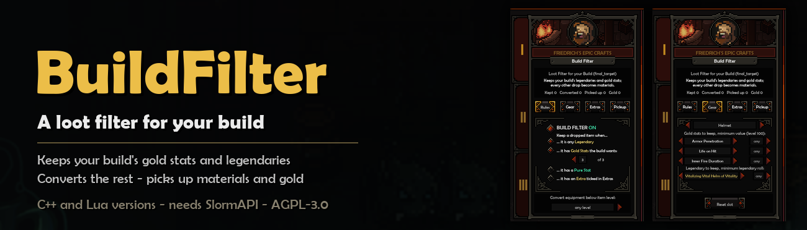
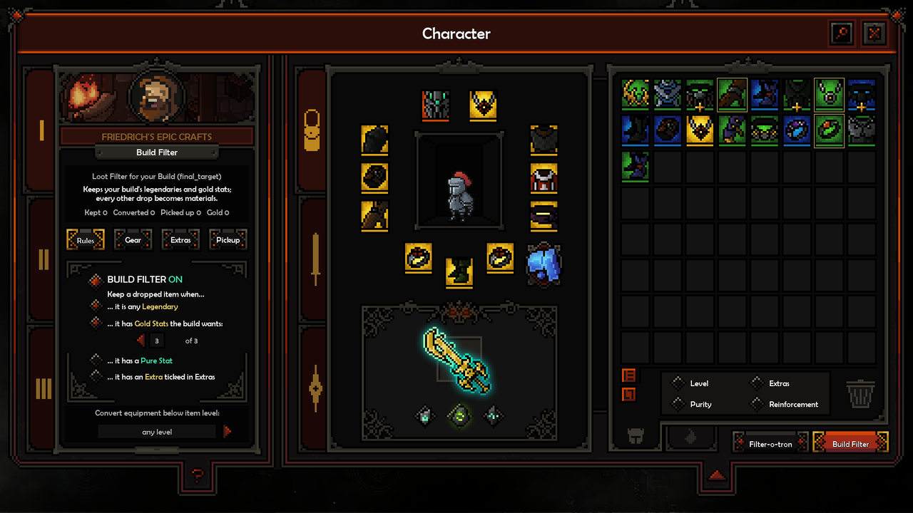
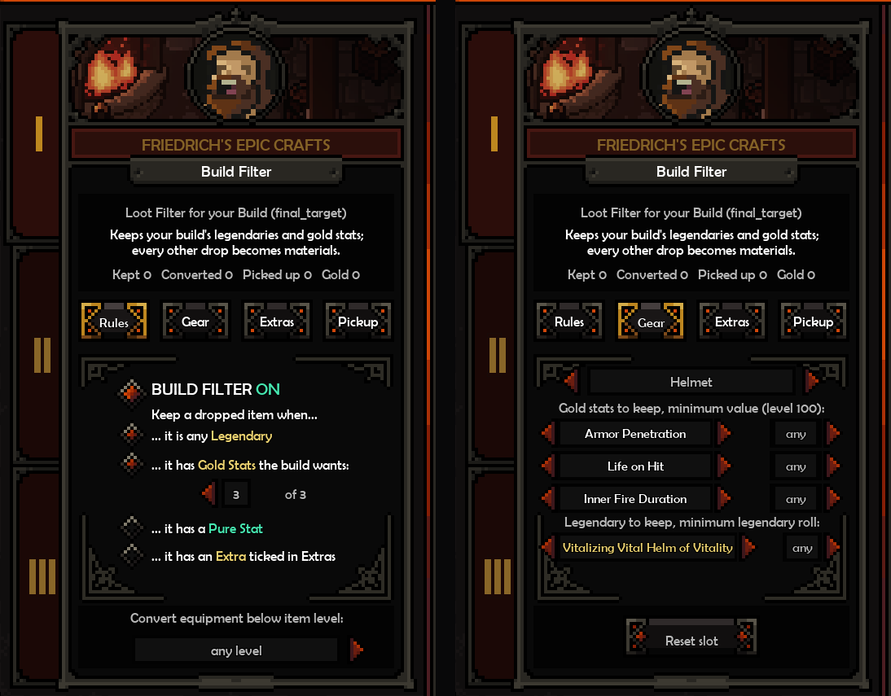

# BuildFilter 1.0.1 — a loot filter for your build (The Slormancer)



Tell it which gold stats and legendaries your build wants, slot by slot; everything else on the ground is turned
into materials with the game's own Filter-o-tron conversion, and materials and gold are picked up for you.

It lives in the inventory: the **Filter-o-tron 3000 Mk.II** button becomes half size and **Build Filter** sits next
to it (red = on, grey = off). Build Filter opens its own page in Friedrich's panel; Filter-o-tron switches back to the
game's page. Everything looks, hovers and clicks like the game's own menus.



## Pages
- **Rules** — turn the filter on/off and choose what keeps a drop:
  - any Legendary, *or* only the Legendary you picked for that slot (click the row to switch);
  - N of 3 wanted **Gold Stats** (the gold lines of an Epic item are the hard ones to reforge);
  - a **Pure** stat (optional); an **Extra** you ticked (optional);
  - convert all equipment below an item level (optional; legendaries excepted).
- **Gear** — for each slot (Helmet … Cape): the 3 gold stats you want and their minimum value (one gold roll per
  click, shown as the real value on a level-100 drop, e.g. Movement Speed ≥ 1.5% … 4% max), the legendary you want
  there and its minimum legendary roll, and Reset slot.
- **Extras** — keep items with +skill mastery for your skills, +affinity with your reaper's smith, or +points in the
  attributes you tick.
- **Pickup** — pick up materials / gold from anywhere (they fly to you like normal pickups), tags on kept drops
  (BUILD, GOLD 3/3, PURE, +2 Whirlwind …), and what filtered items become: Fragments, Goldus, or nothing (hidden).
- **Options > Mods > BuildFilter** — a hotkey that turns the filter on/off (off by default; F5-F12) and the loot log.



A fresh install starts **off**: open the inventory → Build Filter → Gear, set your stats, then turn it on in Rules.
With it on, any non-legendary drop that matches nothing you picked is converted — converted items are gone, exactly
as with the game's own Filter-o-tron.

## Two versions of the same mod
BuildFilter is also an example for [SlormAPI](https://github.com/tsotsas/SlormAPI) modders: the same mod, written
twice, with the same pages, rules and behaviour.

| | C++ (`source/`) | Lua (`lua/BuildFilter.lua`) |
|---|---|---|
| install | `mods/aurie/BuildFilter.dll` | `mods/lua/BuildFilter.lua` |
| reaches SlormAPI through | `SlormAPI_Interface.hpp` (`Request`, `Subscribe`) | the `slorm` table (`slorm.request`, `slorm.on`) |
| game data | read from the game's files (`GameData.hpp`) | SlormAPI's `slot_info`, `stat_info`, `legendary_info` |
| settings saved in | `mods/aurie/BuildFilter/rules.json` | `mods/aurie/SlormAPI/data/lua_BuildFilter.json` |
| loot log | `mods/aurie/BuildFilter/loot_log.txt` | `mods/aurie/SlormAPI/data/lua_BuildFilter.log` |
| changes apply | at the next game start | when you save the file |

Install one of the two. If both are there, the Lua version stays off and the Mods page says why.

## Requirements
- The Slormancer (Windows, Steam version)
- **SlormAPI 1.0.0 or newer** and the Aurie mod loader — the installer below brings both.

## Install

### Easy: the installer (recommended)
1. Download **`BuildFilter-Installer-1.0.1.zip`** from this repository's **Releases** page and unzip it.
2. Close the game, double-click **`Install.bat`** and choose **1**.
3. Start the game from Steam as usual.

The installer finds The Slormancer in your Steam libraries (or asks for the folder) and installs everything in one
step: the Aurie loader (Aurie Core 2.0.2 + YYToolkit 5.0.0c, only if you do not have one yet), SlormAPI and
BuildFilter (the C++ version). Its menu:

| | |
|---|---|
| **1 Install / update** | installs, or updates the mods to the installer's version |
| **2 Repair the loader only** | after a Steam game update or "Verify files" (the new game exe has no loader); keeps your mods and settings |
| **3 Remove the mods** | keeps the Aurie loader and your settings |
| **4 Remove everything** | removes only what the installer added and puts the original game exe back (byte-identical) |
| **5 Status** | shows what is installed |

- It only changes the game folder, never your saves. The original game exe is kept in
  `mods/slormancer-mods-backup/`, and `mods/slormancer-mods.json` records what it added.
- A game that already loads Aurie mods through another mod loader (a `version.dll` loader) keeps it:
  the installer then leaves the game exe alone and adds only the mods.
- Moving the game to another folder or drive is fine: the loader is found relative to the game's folder at every
  launch.
- The loader files are checked against the official Aurie / YYToolkit release checksums before they are used.
  None of the files are digitally signed (the official Aurie and YYToolkit releases are not either), so Windows or
  your antivirus may warn once.

It is SlormAPI's installer with BuildFilter added (`installer/` in the SlormAPI repository).

### Manual
With SlormAPI installed, unzip one of these into `<The Slormancer folder>` (they hold only the game-folder layout):
- C++ version (`BuildFilter-1.0.1.zip`): `mods/Aurie/BuildFilter.dll`.
- Lua version (`BuildFilter-Lua-1.0.1.zip`): `mods/lua/BuildFilter.lua`. It starts while the game runs.

### Vortex
With The Slormancer's Vortex extension and its loader installed, add `SlormAPI-1.0.1.zip` and `BuildFilter-1.0.1.zip`
in Vortex like any other mod (both go to `mods/Aurie`). Don't use the installer then; if you used it before, run it
once more and choose **4** first (the Vortex loader setup needs the original game exe back). The Lua version is a
manual install: copy `BuildFilter.lua` into `mods\lua`.

Names (stats, legendaries, skills) come from the game's own data files, so the lists follow game updates.
BuildFilter never edits your save files directly.

Uninstall: delete `BuildFilter.dll` (and the `mods/aurie/BuildFilter` folder) or `BuildFilter.lua`. The game's own
button and panel come back.

## Build
Visual Studio 2022 (or Build Tools) with the C++ desktop workload and a Windows 10 SDK:

```
msbuild BuildFilter.vcxproj /p:Configuration=Release /p:Platform=x64
```

Output: `bin/BuildFilter.dll`. `deps/SlormAPI` holds SlormAPI's interface header (`SlormAPI_Interface.hpp`) and JSON
helper; `third_party/YYToolkit` the Aurie / YYToolkit SDK headers (AGPL-3.0, YYToolkit 5.0 example plugin). The Lua
version needs no build.

## License
AGPL-3.0. Source code: this repository.
